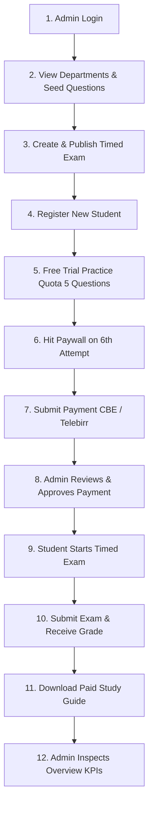

# Assessly API — Complete End-to-End Testing Guide & Flow

This guide walks you through testing the entire Assessly examination platform from initial administrative setup to student practice, payment verification, and timed exam execution.

---

## 🚀 Prerequisites & Environment

1. **Start the API Server**:
   ```bash
   cd backend
   npm run dev
   ```
   *Expected output*: `🚀 Exam Management Backend running on http://localhost:3000`

2. **Setup Postman**:
   - Open Postman $\rightarrow$ **Import** $\rightarrow$ select:
     - `postman/Assessly_API.postman_collection.json`
     - `postman/Assessly_Local.postman_environment.json`
   - In Postman (top right), switch active environment to: **`Assessly Local Environment`**.
   - Confirm `baseUrl` is set to `http://localhost:3000/api/v1`.

---

## 📋 Comprehensive Testing Flow (Step-by-Step)



---

### Step 1: Administrator Authentication
Log in with the pre-seeded Super Admin account to obtain an administrative JWT token.

- **Request**: `POST {{baseUrl}}/auth/login`
- **Body**:
  ```json
  {
    "email": "admin@assessly.com",
    "password": "AdminPassword@123"
  }
  ```
- **Expected Response** (`200 OK`):
  ```json
  {
    "success": true,
    "data": {
      "user": {
        "email": "admin@assessly.com",
        "role": "SUPER_ADMIN"
      },
      "token": "eyJhbGciOi..."
    }
  }
  ```
- **Postman Action**: Copy the `token` value and save it in your environment variable `admin_token`.

---

### Step 2: Retrieve Departments & Create Question
Fetch active departments to obtain a valid `departmentId`.

#### 2.1 List Departments
- **Request**: `GET {{baseUrl}}/departments`
- **Response**: Returns seeded departments (`CS-101`, `MED-101`, `BUS-101`, `LAW-101`).
- **Action**: Copy the `id` of `CS-101` and save it as `department_id`.

#### 2.2 Create Multiple-Choice Question (Admin)
- **Request**: `POST {{baseUrl}}/questions`
- **Header**: `Authorization: Bearer {{admin_token}}`
- **Body**:
  ```json
  {
    "departmentId": "{{department_id}}",
    "topic": "Algorithms",
    "difficulty": "MEDIUM",
    "marks": 2.0,
    "body": "What is the worst-case time complexity of QuickSort?",
    "explanation": "QuickSort degrades to O(n^2) when poor pivot elements are chosen.",
    "status": "PUBLISHED",
    "options": [
      { "optionText": "O(n log n)", "isCorrect": false },
      { "optionText": "O(n^2)", "isCorrect": true },
      { "optionText": "O(n)", "isCorrect": false },
      { "optionText": "O(1)", "isCorrect": false }
    ]
  }
  ```
- **Response** (`201 Created`): Returns created question with options. Save question `id` as `question_id`.

---

### Step 3: Author & Publish Timed Exam (Admin)
Create an exam associated with the department and assign questions.

- **Request**: `POST {{baseUrl}}/exams`
- **Header**: `Authorization: Bearer {{admin_token}}`
- **Body**:
  ```json
  {
    "departmentId": "{{department_id}}",
    "title": "Computer Science Midterm 2026",
    "instructions": "Answer all questions. The timer begins immediately upon starting.",
    "durationMinutes": 45,
    "feedbackPolicy": "IMMEDIATE",
    "status": "PUBLISHED",
    "questionIds": ["{{question_id}}"]
  }
  ```
- **Response** (`201 Created`): Save exam `id` as `exam_id`.

---

### Step 4: Student Registration & Login
Register a new student enrolled in Computer Science.

- **Request**: `POST {{baseUrl}}/auth/register`
- **Body**:
  ```json
  {
    "fullName": "Dawit Bekele",
    "email": "dawit.test@assessly.com",
    "password": "StudentPass@123",
    "departmentIds": ["{{department_id}}"]
  }
  ```
- **Response** (`201 Created`): Returns student profile and token.
- **Action**: Save student's token in `student_token` and user `id` in `student_user_id`.

---

### Step 5: Self-Assessment Practice & Trial Quota Exhaustion

#### 5.1 Browse Sanitized Questions
- **Request**: `GET {{baseUrl}}/questions?departmentId={{department_id}}&page=1&limit=20`
- **Header**: `Authorization: Bearer {{student_token}}`
- **Security Verification**: Notice that `isCorrect` and `explanation` are **not** present in the options or question payload!

#### 5.2 Submit Practice Answer (Free Trial Usage)
- **Request**: `POST {{baseUrl}}/questions/{{question_id}}/practice`
- **Header**: `Authorization: Bearer {{student_token}}`
- **Body**:
  ```json
  {
    "selectedOptionId": "OPTION_ID_FROM_STEP_5.1"
  }
  ```
- **Response** (`200 OK`): Returns `isCorrect: true`, score, and trial quota:
  ```json
  {
    "quotaRemaining": 4
  }
  ```
- **Quota Test**: Submit 4 more practice answers until `quotaRemaining` reaches 0. On the 6th attempt, the API returns:
  - **Status**: `403 Forbidden`
  - **Code**: `"PAYWALL_REQUIRED"`
  - **Message**: *"Free trial quota exhausted (5/5 questions used). Please purchase a package to continue practicing."*

---

### Step 6: Payment Submission (Student)

#### 6.1 View Payment Instructions & Packages
- **Request**: `GET {{baseUrl}}/payments/instructions` (Returns Telebirr and CBE bank account numbers).
- **Request**: `GET {{baseUrl}}/payments/packages` (Returns purchasable semester & annual passes). Save the package `id` as `package_id`.

#### 6.2 Upload Payment Receipt
- **Request**: `POST {{baseUrl}}/payments`
- **Header**: `Authorization: Bearer {{student_token}}`
- **Body** (`form-data`):
  - `packageId`: `{{package_id}}`
  - `departmentId`: `{{department_id}}`
  - `amount`: `399.00`
  - `paymentMethod`: `TELEBIRR`
  - `transactionReference`: `TXN-TB-98234190`
  - `receipt`: `[Attach receipt image or PDF file]`
- **Response** (`201 Created`): Returns payment status `PENDING`. Save payment `id` as `payment_id`.

---

### Step 7: Admin Payment Verification & Entitlement Activation

#### 7.1 Inspect Pending Payments Queue
- **Request**: `GET {{baseUrl}}/payments/admin/pending?page=1&limit=10`
- **Header**: `Authorization: Bearer {{admin_token}}`

#### 7.2 Approve Payment
- **Request**: `POST {{baseUrl}}/payments/{{payment_id}}/approve`
- **Header**: `Authorization: Bearer {{admin_token}}`
- **Body**:
  ```json
  {
    "note": "Verified against Telebirr merchant transaction record"
  }
  ```
- **Response** (`200 OK`): Confirms payment `APPROVED` and shows created `Entitlement` with active validity.

#### 7.3 Student Checks Entitlement Status
- **Request**: `GET {{baseUrl}}/entitlements/status`
- **Header**: `Authorization: Bearer {{student_token}}`
- **Response**: `hasActiveEntitlement: true` for the department!

---

### Step 8: Timed Exam Engine Execution

#### 8.1 Start Exam Attempt
- **Request**: `POST {{baseUrl}}/exams/{{exam_id}}/start`
- **Header**: `Authorization: Bearer {{student_token}}`
- **Response** (`200 OK`):
  ```json
  {
    "attemptId": "ATTEMPT_UUID",
    "durationMinutes": 45,
    "deadlineAt": "2026-11-03T21:45:00.000Z",
    "remainingSeconds": 2700,
    "questions": [...]
  }
  ```
- **Action**: Save `attemptId` as `attempt_id`.

#### 8.2 Submit Exam Answers
- **Request**: `POST {{baseUrl}}/exams/attempts/{{attempt_id}}/submit`
- **Header**: `Authorization: Bearer {{student_token}}`
- **Body**:
  ```json
  {
    "answers": [
      {
        "questionId": "{{question_id}}",
        "selectedOptionId": "OPTION_ID_CHOSEN"
      }
    ]
  }
  ```
- **Response** (`200 OK`):
  ```json
  {
    "success": true,
    "data": {
      "attemptId": "...",
      "status": "COMPLETED",
      "totalQuestions": 1,
      "correctAnswers": 1,
      "obtainedMarks": 2,
      "percentage": 100
    }
  }
  ```

---

### Step 9: Learning Resources & Paywall Download

#### 9.1 Upload Course Syllabus (Admin)
- **Request**: `POST {{baseUrl}}/resources`
- **Header**: `Authorization: Bearer {{admin_token}}`
- **Body** (`form-data`):
  - `title`: "Computer Science Final Review Packet"
  - `departmentId`: `{{department_id}}`
  - `accessLevel`: `PAID`
  - `status`: `PUBLISHED`
  - `file`: `[Attach study packet PDF]`
- **Response**: Save resource `id` as `resource_id`.

#### 9.2 Generate Download URL
- **Request**: `GET {{baseUrl}}/resources/{{resource_id}}/download`
- **Header**: `Authorization: Bearer {{student_token}}`
- **Response** (`200 OK`): Unlocks download URL because the student has an active paid entitlement! (Unpaid students receive HTTP `403 PAYWALL_REQUIRED`).

---

### Step 10: Admin Dashboard & Audit Trail

#### 10.1 System Overview KPIs
- **Request**: `GET {{baseUrl}}/admin/reports/overview`
- **Header**: `Authorization: Bearer {{admin_token}}`
- **Response**: Real-time metrics including total revenue (ETB), registered students, completed exam attempts, and average exam scores.

#### 10.2 Audit Logs
- **Request**: `GET {{baseUrl}}/admin/audit-logs?page=1&limit=20`
- **Header**: `Authorization: Bearer {{admin_token}}`
- **Response**: Paginated audit events verifying `PAYMENT_APPROVED`, `RESOURCE_UPLOADED`, and user actions.

