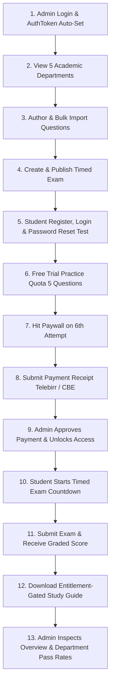

# Assessly API — Complete End-to-End Testing Guide & Flow (v2.0)

This guide walks you through testing the entire Assessly examination platform from initial administrative setup and password recovery to student practice, payment verification, and timed exam execution.

---

## 🚀 Prerequisites & Environment

### 1. Launch the API Server (Local or Docker)

**Option A — Local Development**:
```bash
cd backend
npm run dev
```
*Expected output*: `🚀 Exam Management Backend running on http://localhost:3000`

**Option B — Docker Compose**:
```bash
docker compose up -d
```
*Available at*: `http://localhost:3000` (API) and `http://localhost:8080` (Client)

### 2. Postman Setup
1. Open **Postman** $\rightarrow$ **Import** $\rightarrow$ select:
   - `postman/Assessly_API.postman_collection.json`
   - `postman/Assessly_Local.postman_environment.json`
2. In Postman (top right), switch the active environment to: **`Assessly Local Environment`**.
3. Verify `baseUrl` is set to `http://localhost:3000`.

---

## 📋 Comprehensive Testing Flow (Step-by-Step)



---

### Step 1: Administrator Authentication
Log in with the pre-seeded Super Admin account to obtain an administrative JWT token.

- **Request**: `POST {{baseUrl}}/api/v1/auth/login`
- **Body**:
  ```json
  {
    "email": "admin@assessly.com",
    "password": "AdminPassword@123"
  }
  ```
- **Expected Response** (`200 OK`):
  ```json
  {
    "success": true,
    "data": {
      "user": {
        "email": "admin@assessly.com",
        "role": "SUPER_ADMIN"
      },
      "token": "eyJhbGciOi..."
    }
  }
  ```
- **Postman Action**: The collection automatically extracts `token` and stores it into `{{adminToken}}`.

---

### Step 2: Retrieve Departments
Fetch active departments to inspect the 5 seeded exit exam fields:
- `CS-101`: Computer Science & Software Engineering
- `BUS-101`: Business & Economics
- `ENG-101`: Civil & Environmental Engineering
- `LAW-101`: Jurisprudence & Legal Studies
- `MED-101`: Clinical Medicine & Health Sciences

- **Request**: `GET {{baseUrl}}/api/v1/departments`
- **Response** (`200 OK`): Returns array of department objects.
- **Postman Action**: The script automatically assigns the first department's `id` to `{{departmentId}}`.

---

### Step 3: Question Bank Management

#### 3.1 Create Question (Admin)
- **Request**: `POST {{baseUrl}}/api/v1/questions`
- **Header**: `Authorization: Bearer {{adminToken}}`
- **Body**:
  ```json
  {
    "departmentId": "{{departmentId}}",
    "topic": "Algorithms & Complexity",
    "difficulty": "MEDIUM",
    "marks": 2.0,
    "body": "What is the worst-case time complexity of QuickSort?",
    "explanation": "QuickSort degrades to O(n^2) when poor pivot elements are chosen.",
    "status": "PUBLISHED",
    "options": [
      { "optionText": "O(n log n)", "isCorrect": false },
      { "optionText": "O(n^2)", "isCorrect": true },
      { "optionText": "O(n)", "isCorrect": false },
      { "optionText": "O(1)", "isCorrect": false }
    ]
  }
  ```
- **Postman Action**: Stores question `id` into `{{questionId}}`.

#### 3.2 Bulk Import Questions (Admin)
- **Request**: `POST {{baseUrl}}/api/v1/questions/bulk-import`
- **Header**: `Authorization: Bearer {{adminToken}}`
- **Body**:
  ```json
  {
    "departmentId": "{{departmentId}}",
    "questions": [
      {
        "topic": "Data Structures",
        "difficulty": "EASY",
        "marks": 1.0,
        "body": "Which data structure follows the LIFO principle?",
        "explanation": "Stacks operate on Last-In, First-Out (LIFO).",
        "status": "PUBLISHED",
        "options": [
          { "optionText": "Queue", "isCorrect": false },
          { "optionText": "Stack", "isCorrect": true },
          { "optionText": "Linked List", "isCorrect": false },
          { "optionText": "Binary Tree", "isCorrect": false }
        ]
      }
    ]
  }
  ```

---

### Step 4: Create & Publish Timed Exam
Author an official exit mock exam.

- **Request**: `POST {{baseUrl}}/api/v1/exams`
- **Header**: `Authorization: Bearer {{adminToken}}`
- **Body**:
  ```json
  {
    "departmentId": "{{departmentId}}",
    "title": "Computer Science Exit Examination Simulation",
    "durationMinutes": 60,
    "feedbackPolicy": "AFTER_SUBMISSION",
    "status": "PUBLISHED",
    "questionIds": ["{{questionId}}"]
  }
  ```
- **Postman Action**: Stores created exam `id` into `{{examId}}`.

---

### Step 5: Student Authentication & Password Recovery

#### 5.1 Register Student
- **Request**: `POST {{baseUrl}}/api/v1/auth/register`
- **Body**:
  ```json
  {
    "fullName": "Abebe Bikila",
    "email": "student@assessly.com",
    "password": "SecurePassword123!",
    "departmentIds": ["{{departmentId}}"]
  }
  ```
- **Postman Action**: Automatically saves student `token` into `{{authToken}}`.

#### 5.2 Test Forgot Password Flow
- **Request**: `POST {{baseUrl}}/api/v1/auth/forgot-password`
- **Body**:
  ```json
  {
    "email": "student@assessly.com"
  }
  ```
- **Response** (`200 OK`):
  ```json
  {
    "success": true,
    "message": "If this email is registered, password reset instructions have been sent."
  }
  ```
- **Security Check**: Generates a 32-byte token, hashes with SHA-256 for the database, and delivers unhashed token via live SMTP.

#### 5.3 Change Password
- **Request**: `POST {{baseUrl}}/api/v1/auth/change-password`
- **Header**: `Authorization: Bearer {{authToken}}`
- **Body**:
  ```json
  {
    "currentPassword": "SecurePassword123!",
    "newPassword": "NewSecurePassword456!"
  }
  ```

---

### Step 6: Free Trial Quota & Paywall Enforcement

#### 6.1 Check Initial Quota
- **Request**: `GET {{baseUrl}}/api/v1/entitlements/status`
- **Header**: `Authorization: Bearer {{authToken}}`
- **Expected**: `freeTrialQuestionsRemaining: 5`, `hasActiveSubscription: false`.

#### 6.2 Submit 5 Practice Answers
Submit answers to questions 1 through 5:
- **Request**: `POST {{baseUrl}}/api/v1/questions/{{questionId}}/answer`
- **Header**: `Authorization: Bearer {{authToken}}`
- **Body**: `{ "selectedOptionId": "..." }`
- **Result**: Each answer submission decrements the remaining quota (`4 -> 3 -> 2 -> 1 -> 0`).

#### 6.3 6th Attempt Triggers Paywall (FR-ACCESS)
- **Request**: `POST {{baseUrl}}/api/v1/questions/{{questionId}}/answer`
- **Expected Response** (`403 Forbidden`):
  ```json
  {
    "success": false,
    "code": "PAYWALL_REQUIRED",
    "message": "You have exhausted your 5 free trial practice questions."
  }
  ```

---

### Step 7: Payment Submission (Telebirr / CBE)

#### 7.1 View Dynamic Instructions & Packages
- **Instructions**: `GET {{baseUrl}}/api/v1/payments/instructions`
- **Packages**: `GET {{baseUrl}}/api/v1/payments/packages` (stores package `id` in `{{packageId}}`).

#### 7.2 Submit Receipt
- **Request**: `POST {{baseUrl}}/api/v1/payments`
- **Header**: `Authorization: Bearer {{authToken}}`
- **Body** (`multipart/form-data`):
  - `packageId`: `{{packageId}}`
  - `channel`: `TELEBIRR`
  - `transactionRef`: `FTX-1029384756`
  - `receipt`: [Select image or PDF file]
- **Postman Action**: Stores submission `id` into `{{paymentId}}`.

---

### Step 8: Administrator Verification & Entitlement Unlock

#### 8.1 Admin Checks Pending Queue
- **Request**: `GET {{baseUrl}}/api/v1/payments/admin/queue?status=PENDING`
- **Header**: `Authorization: Bearer {{adminToken}}`

#### 8.2 Admin Approves Payment
- **Request**: `POST {{baseUrl}}/api/v1/payments/admin/{{paymentId}}/approve`
- **Header**: `Authorization: Bearer {{adminToken}}`
- **Body**: `{ "reviewNotes": "Telebirr receipt verified on merchant portal." }`
- **Result**: Activates student entitlement, marks payment `APPROVED`, and writes to `AuditLog`.

---

### Step 9: Timed Exam Execution

#### 9.1 Start Attempt (Begins Countdown)
- **Request**: `POST {{baseUrl}}/api/v1/exams/{{examId}}/attempts`
- **Header**: `Authorization: Bearer {{authToken}}`
- **Expected Response** (`201 Created`):
  ```json
  {
    "success": true,
    "data": {
      "attempt": {
        "id": "...",
        "status": "IN_PROGRESS",
        "deadlineAt": "2026-11-06T22:45:00.000Z"
      },
      "questions": [...]
    }
  }
  ```
- **Postman Action**: Stores attempt `id` into `{{attemptId}}`.

#### 9.2 Submit Exam Answers
- **Request**: `POST {{baseUrl}}/api/v1/exams/attempts/{{attemptId}}/submit`
- **Header**: `Authorization: Bearer {{authToken}}`
- **Body**:
  ```json
  {
    "answers": [
      {
        "questionId": "{{questionId}}",
        "selectedOptionId": "..."
      }
    ]
  }
  ```
- **Expected Response** (`200 OK`): Returns computed score, percentage, passing status, and answer review breakdown.

---

### Step 10: Learning Resource Paywall & Download

- **Request**: `GET {{baseUrl}}/api/v1/resources/{{resourceId}}/download`
- **Header**: `Authorization: Bearer {{authToken}}`
- **Result**: Streams PDF or returns signed URL since student now holds an approved active entitlement!

---

### Step 11: Admin Analytics & Platform Settings

#### 11.1 Real-Time Overview KPIs
- **Request**: `GET {{baseUrl}}/api/v1/admin/reports/overview`
- **Header**: `Authorization: Bearer {{adminToken}}`
- **Metrics**: Total revenue (ETB), registered students, active entitlements, and attempt aggregates.

#### 11.2 Department Pass Rates & Exam Statistics
- **Request**: `GET {{baseUrl}}/api/v1/admin/reports/departments`
- **Header**: `Authorization: Bearer {{adminToken}}`
- **Metrics**: Per-department student count, exam count, attempts, average score percentage, and pass rate.

#### 11.3 Audit Trail
- **Request**: `GET {{baseUrl}}/api/v1/admin/audit-logs?page=1&limit=20`
- **Header**: `Authorization: Bearer {{adminToken}}`

#### 11.4 Manage Platform Settings
- **Get Settings**: `GET {{baseUrl}}/api/v1/admin/settings`
- **Update Settings**: `PATCH {{baseUrl}}/api/v1/admin/settings`
- **Body**:
  ```json
  {
    "telebirrNumber": "0938756685",
    "cbeAccount": "1000126789487",
    "freeTrialQuestions": 5,
    "passMarkPercentage": 50
  }
  ```
