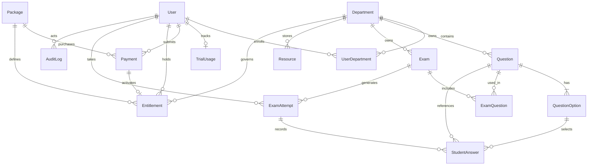

# Assessly Platform — Technical Architecture & System Documentation

> **Version**: 1.0.0  
> **Specification**: SRS v1.0 (02 Nov 2026)  
> **Database**: Supabase PostgreSQL (Managed Cloud)  
> **Runtime**: Node.js v24 (ES Modules) + TypeScript 5.7+

---

## 1. System Architecture Overview

Assessly is an enterprise-grade online examination and self-assessment platform built for academic institutions and professional qualification candidates. The backend follows a modular, layered architecture adhering to Domain-Driven Design (DDD) principles:

```
                  ┌────────────────────────────────────────┐
                  │          Client Applications           │
                  │   (Next.js Web / Postman / Mobile)     │
                  └───────────────────┬────────────────────┘
                                      │ HTTPS / REST
                                      ▼
                  ┌────────────────────────────────────────┐
                  │             Express 5 API              │
                  │  (Helmet, CORS, Rate Limiter, Multer)  │
                  └───────────────────┬────────────────────┘
                                      │
            ┌─────────────────────────┼─────────────────────────┐
            ▼                         ▼                         ▼
   ┌─────────────────┐       ┌─────────────────┐       ┌─────────────────┐
   │   Auth & RBAC   │       │  Question Bank  │       │   Timed Exam    │
   │  (JWT / Bcrypt) │       │ & Sanitization  │       │  Engine & Timer │
   └─────────────────┘       └─────────────────┘       └─────────────────┘
            ▼                         ▼                         ▼
   ┌─────────────────┐       ┌─────────────────┐       ┌─────────────────┐
   │ Payment & CBE / │       │ Learning Resource│       │ Admin Analytics │
   │ Telebirr Review │       │  Paywall System │       │  & Audit Trail  │
   └─────────────────┘       └─────────────────┘       └─────────────────┘
            │                         │                         │
            └─────────────────────────┼─────────────────────────┘
                                      │
                                      ▼
                  ┌────────────────────────────────────────┐
                  │              Prisma ORM                │
                  │    (Typed Schema & Client Mapping)     │
                  └───────────────────┬────────────────────┘
                                      │
                         ┌────────────┴────────────┐
                         ▼                         ▼
               ┌───────────────────┐     ┌───────────────────┐
               │    PostgreSQL     │     │ Storage Provider  │
               │  (Supabase Cloud) │     │ (Local Disk / S3) │
               └───────────────────┘     └───────────────────┘
```

---

## 2. Core Functional Modules

### 2.1 Authentication & Role-Based Access Control (FR-AUTH)
- **Roles**:
  - `STUDENT`: Self-assessment practice, timed exams, payment submissions, resource downloads.
  - `ADMIN`: Question bank management, exam authoring, receipt verification, resource uploads.
  - `SUPER_ADMIN`: System-wide access, user role modifications, account activation/suspension.
- **Security & Password Hashing**:
  - Passwords hashed using `bcryptjs` with 12 salt rounds.
  - JWT tokens signed with `jsonwebtoken` (HS256 algorithm) containing `userId`, `email`, and `role`.
  - Real-time account status checks: Tokens belonging to `SUSPENDED` or `INACTIVE` accounts are immediately rejected in [`auth.middleware.ts`](../backend/src/common/middlewares/auth.middleware.ts).
- **Atomic Registration**:
  - Creating a student atomically records their User profile, links academic `UserDepartment` enrollments, and initializes a 5-question `TrialUsage` ledger.

### 2.2 Question Bank & Answer Key Sanitization (FR-Q, AC-09)
- **Single-Choice MCQ Invariant**:
  - Enforces that any published question has at least 2 options and **exactly 1 correct answer** (`isCorrect: true`).
- **Data Protection & Anti-Cheating (AC-09)**:
  - When questions are queried by students or delivered during exam attempts, the backend strictly omits `isCorrect` from options and `explanation` from questions.
  - The correct answer key is strictly retained server-side until official submission scoring.

### 2.3 Timed Exam Engine (FR-EXAM)
- **Server-Side Deadline Enforcement**:
  - When an exam attempt starts (`POST /api/v1/exams/:id/start`), the server locks:
    $$\text{deadlineAt} = \text{now} + (\text{durationMinutes} \times 60 \times 1000)$$
  - Deadlines cannot be manipulated by client device clock changes.
  - A 30-second network latency buffer is granted for in-flight submissions. Submissions past the buffer are marked with status `TIMED_OUT`.
- **Automated Grading & Scoring (AC-10)**:
  - Answers are compared against the database answer keys in a single atomic transaction.
  - Scores and percentages are computed dynamically:
    $$\text{percentage} = \left(\frac{\text{obtainedMarks}}{\text{totalMarks}}\right) \times 100$$
- **Feedback Policies**:
  - `IMMEDIATE`: Full answer review and explanations available immediately upon submission.
  - `AFTER_SUBMISSION`: Score summary returned upon completion.
  - `AFTER_EXAM_CLOSES`: Scores withheld until exam close date.

### 2.4 Quota & Manual Payment Verification (FR-ACCESS, FR-PAY)
- **Free Trial Ledger (`TrialUsage`)**:
  - Unpaid students receive a free trial quota of 5 questions.
  - Submitting practice answers atomically increments `usedCount`. Upon reaching quota (`usedCount >= 5`), the system returns `HTTP 403 Forbidden` with error code `PAYWALL_REQUIRED`.
- **Manual Payment Flow (Telebirr & CBE)**:
  - Students transfer funds via Telebirr or Commercial Bank of Ethiopia (CBE) and submit transaction reference codes and receipt screenshots.
  - Submissions enter a pending queue (`PENDING`) awaiting Admin review.
  - Admin approval executes an atomic transaction:
    1. Updates payment status to `APPROVED`.
    2. Activates a departmental or platform-wide `Entitlement` with defined validity (`expiresAt`).
    3. Emits an immutable record to `AuditLog`.

### 2.5 Learning Resource Management (FR-RES)
- Supports PDF syllabi, lecture notes, formula sheets, and past papers.
- **Paywall Access Control**:
  - `FREE`: Available to all enrolled students.
  - `TRIAL`: Accessible during the trial window.
  - `PAID`: Strictly checks whether student has an active `Entitlement` for the department. Local streaming or signed URLs are denied if unauthorized (`PAYWALL_REQUIRED`).

### 2.6 Admin Analytics & Audit Logs (FR-ADMIN, FR-AUD)
- **Overview KPIs (`GET /api/v1/admin/reports/overview`)**:
  - Student and admin counts, active paid subscriptions, pending payment verification queue, total revenue generated (ETB), question counts, exam attempts, and department breakdowns.
- **Audit Logs (`GET /api/v1/admin/audit-logs`)**:
  - Paginated audit trail capturing actor, action (`PAYMENT_APPROVED`, `RESOURCE_UPLOADED`, `ROLE_CHANGED`), affected entity, and metadata diffs.

---

## 3. Database Schema & Entity Relationships



---

## 4. Security Architecture

| Security Domain | Implementation | Defense Rationale |
| :--- | :--- | :--- |
| **HTTP Security Headers** | `helmet` middleware | Mitigates Clickjacking, MIME sniffing, and XSS attacks. |
| **Authentication Throttling** | Sliding-window `rate-limiter` | 15 requests / min on `/auth/login` and `/auth/register` to prevent brute force. |
| **File Traversal Defense** | `path.basename` + safe resolves | Prevents directory traversal attacks (`../../etc/passwd`). |
| **Stored Script Execution** | Extension & MIME whitelisting | Blocks `.html`, `.svg`, `.php`, `.js`, `.exe` uploads; sets `Content-Security-Policy: default-src 'none'`. |
| **IDOR Protection** | Ownership verification checks | Students can only access their own payment receipts; paid materials require valid entitlement. |
| **Request Tampering** | `Object.defineProperty` on Express | Safely overrides `req.query` and `req.params` without prototype getter conflicts. |
| **Database Privacy** | Prisma error interception | Prevents schema leakage or internal DB errors (`P2002` maps to 409 Conflict). |

