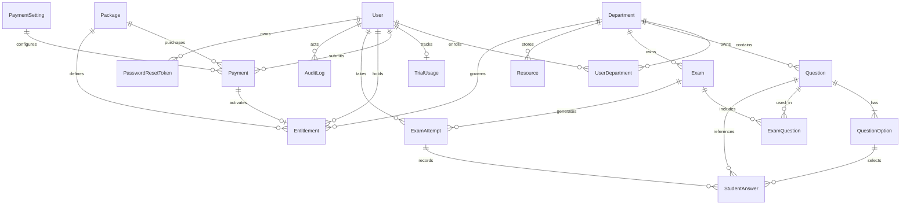

# Assessly Platform — Technical Architecture & System Documentation

> **Version**: 2.0.0  
> **Specification**: SRS v1.0 (Higher Education Examination & Assessment Platform)  
> **Database**: Supabase PostgreSQL (Managed Cloud)  
> **Runtime**: Node.js v20+ (ES Modules) + TypeScript 5.7+  
> **Client Framework**: React 19 + TanStack Start / Router + Tailwind CSS v4  
> **Deployment**: Multi-Stage Docker & Docker Compose  

---

## 1. System Architecture Overview

Assessly is an enterprise-grade higher education exit examination, mock testing, and academic assessment platform built for Ethiopian university candidates and faculty administrators. The backend adheres to Domain-Driven Design (DDD) principles with strict separation between routing, validation schemas, business services, and database persistence:

```
                  ┌──────────────────────────────────────────────┐
                  │              Client Applications             │
                  │   (TanStack Start Web / Postman Collection)  │
                  └──────────────────────┬───────────────────────┘
                                         │ HTTPS / REST (Port 8080 -> 3000)
                                         ▼
                  ┌──────────────────────────────────────────────┐
                  │                Express 5 API                 │
                  │   (Helmet, CORS, Rate Limiter, Multer Upload) │
                  └──────────────────────┬───────────────────────┘
                                         │
        ┌────────────────────────────────┼────────────────────────────────┐
        ▼                                ▼                                ▼
┌─────────────────┐            ┌──────────────────┐             ┌───────────────────┐
│   Auth & RBAC   │            │  Question Bank   │             │    Timed Exam     │
│  (JWT / Bcrypt) │            │ & Sanitization   │             │   Engine & Timer  │
│ Password Reset  │            │  5 Departments   │             │  Scoring & Grade  │
└─────────────────┘            └──────────────────┘             └───────────────────┘
        ▼                                ▼                                ▼
┌─────────────────┐            ┌──────────────────┐             ┌───────────────────┐
│ Payment Engine  │            │ Learning Resource│             │  Admin Analytics  │
│  Telebirr & CBE │            │  Paywall System  │             │   & Audit Trail   │
│ Dynamic Settings│            │  (Free vs Paid)  │             │  Pass Rate Trends │
└─────────────────┘            └──────────────────┘             └───────────────────┘
        │                                │                                │
        └────────────────────────────────┼────────────────────────────────┘
                                         │
                                         ▼
                  ┌──────────────────────────────────────────────┐
                  │                  Prisma ORM                  │
                  │       (18 Typed Models & PostgreSQL Enums)   │
                  └──────────────────────┬───────────────────────┘
                                         │
                         ┌───────────────┴───────────────┐
                         ▼                               ▼
               ┌───────────────────┐           ┌───────────────────┐
               │    PostgreSQL     │           │  Storage Provider │
               │  (Supabase Cloud) │           │ (Local Disk / S3) │
               └───────────────────┘           └───────────────────┘
```

---

## 2. Core Functional Modules

### 2.1 Authentication, RBAC & Password Lifecycle (FR-AUTH)

- **Roles & Permissions**:
  - `STUDENT`: Department self-assessment practice, timed mock exams, payment receipt submission, and learning resource downloads.
  - `ADMIN`: Exit exam question authoring, bulk CSV/JSON imports, exam publishing, receipt verification, and study material uploads.
  - `SUPER_ADMIN`: User role elevation/demotion, account activation/suspension, global settings configuration, and audit log inspection.
- **Password Security**:
  - Passwords hashed with `bcryptjs` using 12 salt rounds.
  - JWT tokens signed with `jsonwebtoken` (HS256 algorithm) containing claims: `userId`, `email`, and `role`.
  - Immediate token revocation: Accounts flagged as `SUSPENDED` or `INACTIVE` are denied access at [`auth.middleware.ts`](../backend/src/common/middlewares/auth.middleware.ts).
- **Password Recovery Architecture**:
  - **Forgot Password**: Generates a 32-byte cryptographically secure pseudorandom token (`crypto.randomBytes(32).toString('hex')`).
  - **Hash-at-Rest**: The database stores a SHA-256 hash (`crypto.createHash('sha256').update(rawToken).digest('hex')`) in the `PasswordResetToken` table to protect tokens even in the event of database dumps.
  - **Email Delivery**: The unhashed token is sent to the student's email via live SMTP (`nodemailer`), directing to `${CLIENT_URL}/reset-password?token=...`.
  - **Token Invalidation**: Reset tokens expire after 1 hour and are atomically marked `usedAt` upon consumption.
  - **Change Password**: Authenticated users can update their password provided their `currentPassword` verifies against bcrypt.

### 2.2 Multi-Department Question Bank & Sanitization (FR-Q, AC-09)

- **Academic Exit Exam Coverage**:
  - Computer Science & Software Engineering (`CS-101`)
  - Business & Economics (`BUS-101`)
  - Civil & Environmental Engineering (`ENG-101`)
  - Jurisprudence & Legal Studies (`LAW-101`)
  - Clinical Medicine & Health Sciences (`MED-101`)
- **Single-Choice MCQ Invariant**:
  - Enforces that any published question has at least 2 options and **exactly 1 correct answer** (`isCorrect: true`).
- **Answer Key Sanitization (AC-09)**:
  - When questions are listed for practice or served during timed exams, the backend strips `isCorrect` from options and `explanation` from questions.
  - The answer key is strictly retained server-side until official submission scoring.
- **Bulk Question Import**:
  - Supports bulk ingestion via JSON payload or formatted CSV text.

### 2.3 Timed Exam Engine (FR-EXAM)

- **Server-Side Deadline Enforcement**:
  - When an exam attempt starts (`POST /api/v1/exams/:id/attempts` or `/:id/start`), the server locks:
    $$\text{deadlineAt} = \text{now} + (\text{durationMinutes} \times 60 \times 1000)$$
  - Deadlines cannot be manipulated by client device clock manipulation.
  - A 30-second network latency buffer is granted for in-flight submissions. Submissions past the buffer are marked with status `TIMED_OUT`.
- **Background Expiration Worker**:
  - A periodic worker sweeps expired active attempts every 60 seconds in [`server.ts`](../backend/src/server.ts), auto-closing timed-out sessions.
- **Automated Grading & Scoring (AC-10)**:
  - Answers are evaluated against database answer keys in a single atomic database query.
  - Scores and percentages are computed dynamically:
    $$\text{percentage} = \left(\frac{\text{obtainedMarks}}{\text{totalMarks}}\right) \times 100$$
- **Feedback Policies**:
  - `IMMEDIATE`: Full answer review and explanations available immediately upon submission.
  - `AFTER_SUBMISSION`: Score summary returned upon completion.
  - `AFTER_EXAM_CLOSES`: Scores withheld until exam close date.

### 2.4 Quota & Manual Payment Verification (FR-ACCESS, FR-PAY)

- **Free Trial Ledger (`TrialUsage`)**:
  - Unpaid students receive a free trial quota of 5 practice questions.
  - Submitting practice answers atomically increments `usedCount`. Once `usedCount >= 5`, the server returns `HTTP 403 Forbidden` with error code `PAYWALL_REQUIRED`.
- **Dynamic Payment Instructions & Channels**:
  - Dynamic `PaymentSetting` model maintains active Telebirr and CBE account details.
  - Instruction steps automatically synchronize with current phone numbers (`0938756685`) and bank accounts (`1000126789487`).
- **Receipt Verification Workflow**:
  - Students transfer funds and upload receipt screenshots or PDFs along with transaction references.
  - Submissions enter `PENDING` queue awaiting admin review.
  - Admin approval executes an atomic transaction:
    1. Updates payment status to `APPROVED`.
    2. Activates a departmental or platform-wide `Entitlement` with defined validity (`expiresAt`).
    3. Emits an immutable record to `AuditLog`.
  - Admin rejection requires a mandatory rejection reason (`FR-PAY-10`).
- **Cross-Device Storage Resilience**:
  - Local storage service implements cross-filesystem fallback (`EXDEV: cross-device link not permitted`), streaming via `fs.copyFile` and `fs.unlink` when temporary upload buffers reside on separate mount points (e.g. `tmpfs` vs `ext4`).

### 2.5 Learning Resource Management (FR-RES)

- Supports PDF syllabi, lecture notes, formula sheets, and past papers.
- **Paywall Access Control**:
  - `FREE`: Available to all enrolled students.
  - `TRIAL`: Accessible during the trial window.
  - `PAID`: Strictly checks whether student has an active `Entitlement` for the department. Unauthorized requests are rejected with `403 PAYWALL_REQUIRED`.

### 2.6 Admin Analytics & Audit Logs (FR-ADMIN, FR-AUD)

- **Overview KPIs (`GET /api/v1/admin/reports/overview`)**:
  - Student and admin counts, active paid subscriptions, pending payment verification queue, total revenue generated (ETB), question counts, exam attempts, and department breakdowns.
- **Department Performance Analytics (`GET /api/v1/admin/reports/departments`)**:
  - Per-department active students, question bank inventory, total attempts, average marks, and pass rate percentages.
- **Audit Logs (`GET /api/v1/admin/audit-logs`)**:
  - Paginated audit trail capturing actor, action (`PAYMENT_APPROVED`, `RESOURCE_UPLOADED`, `ROLE_CHANGED`), affected entity, and metadata diffs.

---

## 3. Database Schema & Entity Relationships



---

## 4. Containerization & Production Deployment

The platform is containerized using multi-stage Alpine Linux containers orchestrated via Docker Compose:

### 4.1 Backend Container (`backend/Dockerfile`)
- **Stage 1 (Builder)**: `node:20-alpine` with `openssl`. Runs `npm ci`, generates Prisma client query engines, compiles TypeScript via `tsc`, and executes `npm prune --omit=dev`.
- **Stage 2 (Runner)**: Minimal `node:20-alpine` production image. Runs under unprivileged `node` user on port `3000`. Mounts `/app/uploads` volume for receipt and file persistence.
- **Healthcheck**: Regular HTTP probe to `/api/v1/health` verifying database pool connectivity.

### 4.2 Frontend Container (`frontend/Dockerfile`)
- `node:20-alpine` container running the validated TanStack Start application on port `8080`.
- Configured with `HOST=0.0.0.0` and `PORT=8080`.

### 4.3 Orchestration (`docker-compose.yml`)
```yaml
services:
  backend:
    build: ./backend
    container_name: assessly-backend
    ports: ["3000:3000"]
    env_file: ./backend/.env
    volumes: ["./backend/uploads:/app/uploads"]
    healthcheck:
      test: ["CMD-SHELL", "wget --spider http://localhost:3000/api/v1/health || exit 1"]

  frontend:
    build: ./frontend
    container_name: assessly-frontend
    ports: ["8080:8080"]
    depends_on:
      backend:
        condition: service_healthy
```

---

## 5. Security Architecture

| Security Domain | Implementation | Defense Rationale |
| :--- | :--- | :--- |
| **HTTP Security Headers** | `helmet` middleware | Mitigates Clickjacking, MIME sniffing, and XSS attacks. |
| **Authentication Throttling** | Sliding-window `rate-limiter` | 15 requests / min on auth endpoints to prevent brute force. |
| **Password Token Hashing** | SHA-256 (`crypto.createHash`) | Unhashed tokens never touch database tables; prevents credential reuse from leaked backups. |
| **File Traversal Defense** | `path.basename` + safe resolves | Prevents directory traversal attacks (`../../etc/passwd`). |
| **Cross-Device Storage** | Copy-stream + unlink fallback | Prevents `EXDEV` filesystem boundary crashes when running in containerized environments. |
| **Stored Script Execution** | Extension & MIME whitelisting | Blocks `.html`, `.svg`, `.php`, `.js`, `.exe` uploads; sets `Content-Security-Policy: default-src 'none'`. |
| **IDOR Protection** | Ownership verification checks | Students can only access their own payment receipts; paid materials require valid entitlement. |
| **Request Tampering** | `Object.defineProperty` on Express | Safely overrides `req.query` and `req.params` without prototype getter conflicts. |
| **Database Privacy** | Prisma error interception | Prevents schema leakage or internal DB errors (`P2002` maps to 409 Conflict). |

---

## 6. Automated Testing & Verification

The backend test suite runs natively with Node.js test runner and TypeScript tsx imports:

```bash
cd backend && npm test
```

### Coverage (16 Suites, 53 Passing Tests, 0 Failures):
1. **Admin Schema & Input Validation**: Query filters, pagination, strict user status/role rules.
2. **Admin Operations Self-Protection**: Super Admin anti-demotion guardrail, anti-self-deactivation.
3. **Department Analytics Computation**: Department average scores, pass rate calculations, zero-attempt division safety.
4. **Password Utility**: Bcrypt hashing integrity and salt round verification.
5. **JWT Token Lifecycle**: Signing, expiration, role payload validation, and signature tampering rejection.
6. **Auth Input Validation**: Registration email syntax, password complexity, and login schemas.
7. **Password Recovery & Reset**: Forgot-password, reset-password, and change-password schemas.
8. **Exam Configuration Validation**: Exam title, durations, feedback policies, and question links.
9. **Exam Grading Engine**: Dynamic percentage and obtained score calculations.
10. **Timer Enforcement**: Server-side `deadlineAt` locks, grace period latency buffer, and completed attempt locking.
11. **Payment Schemas**: Transaction reference checks, package bindings, and admin decision validation.
12. **Payment State Transitions**: `PENDING -> APPROVED` entitlement activation and duplicate transition blocks.
13. **Question Bank Schemas**: MCQ 4-option invariants, single correct answer requirement, and draft/published validation.
14. **Student Answer Sanitization**: Hiding `isCorrect` and explanations from students, trial quota tracking.
15. **Resource Metadata Schemas**: Access level rules, department UUID validation, and query parameters.
16. **Resource Access Control**: Free vs Trial vs Paid entitlement gatekeeping.
